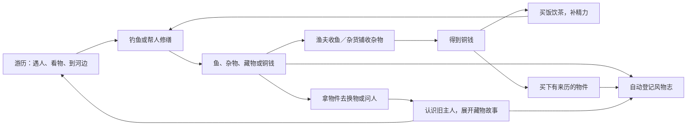

# 《清明上河图》全卷共享玩法：钓鱼、收藏、交易与精力

2026-10-01｜主角：初入汴京的书生阿青｜从第二关起接入，收藏贯穿六区

**当前执行范围（晓梦已确认）**：先把第二关D区完整做好；其他区域只保留后续接口与续篇线索，本轮不展开制作。可直接开始的主控、剧情、场景、核心、玩法、资产、演出、整合和验收提示词见[第二关开发提示词包](/Users/zhengrui/Documents/ChatGPT/清明上河图/第二关开发提示词/README.md)。本文件保留全卷方向，实际开发阶段与并行边界以提示词包为准。

## 1. 已采纳的方向与本次状态

晓梦确认增加：河边钓鱼；鱼和珍稀物品登记到阿青的收藏夹“风物志”；杂货铺收购杂物、出售藏物；渔夫收购鱼；修缮差事提供实物或钱的报酬；以物换物；用钱吃饭、喝茶补充精力；做事消耗精力，精力随游戏时间缓慢下降。

收藏是全卷持续的游历目标。每一区的人物、器物与见闻进入同一册风物志，不另开六个互不相通的收藏夹。河岸适合钓鱼的区域提供钓点，其他区域通过赠物、买卖、换物和差事接入收藏。

《哑舍》提供的启发是让器物承载人的经历：一件东西可以卖钱，也可能牵出一桩旧事。这里借鉴这个叙事思路，创作属于汴京人物的新故事。当前方案采用可见磨损、刻痕、使用经历和人物证言展开来历；是否加入超自然表现仍未定，不由参考作品自动引入。[《哑舍》出版介绍](https://www.megbook.com.tw/mall/detail.jsp?proID=1751313)

**本次完成的是玩法与开发规格，尚未接入可玩游戏。** 下列人物名、藏物经历、概率、价格与精力参数均为首版设计；数值需原型与真人试玩验证。已存在的源码接口见第 10 节，不把拟新增模块称为现有实现。

配套：[全卷六区规划](/Users/zhengrui/Documents/ChatGPT/清明上河图/清明上河图_全卷六区规划.md)、[第二关原画场景清单](/Users/zhengrui/Documents/ChatGPT/清明上河图/第二关_虹桥至城门_原画场景清单.md)、[逐步执行方案](/Users/zhengrui/Documents/ChatGPT/清明上河图/清明上河图3D游戏_逐步执行方案_v1.3.md)。

## 2. 玩家怎样循环游历



玩家要作的小决定是：留下、卖出、换出去，还是带着物件找人问来历。卖掉鱼和重复杂物能支付饭钱；短差事能带来更稳定的收入；有故事的物件能让玩家愿意回访。经营先做收入、支出和以物换物的闭环，玩家自己的摊位、员工与生产线暂不进入首版。

界面用“铜钱”，单位为“文”，内部只存一个整数余额。可以在设计沟通中继续称金币，但不把金质硬币做成汴京小额交易的通用外观。钱陌制度作为可选文化条目，不要求玩家换算；本方案所有定价都是游戏平衡值。《东京梦华录·都市钱陌》提示当时计钱并非现代统一进位式标价。[卷三原文](https://zh.wikisource.org/zh-hans/東京夢華錄/卷三)

## 3. 风物志：记录与实物分开

### 3.1 收到了什么

同一册书中设置“人物”“地标与风俗”“水中所得”“器物藏品”“故事”几个页签；统一入口可暂定为“风物志 / 行囊 I”。原有地标介绍、虹桥见闻及四篇人物故事继续使用各自的解锁规则。

| 项目 | 行囊中的实物 | 风物志中的永久记录 |
|---|---|---|
| 钓到的鱼 | 当前数量，可卖给渔夫 | 首次钓得地点、次数、鱼种外观与文化说明 |
| 普通杂物 | 当前数量，可卖或作为换物材料 | 首次所得、用途；不为每块碎物写长篇 |
| 有故事的藏物 | 独立物件，可收藏、换物；允许出售的需主动解除保护 | 外观、取得方式、旧主人、来历与故事进度 |
| 已借的任务用具 | 受任务或所有权约束，不能拿去买卖 | 记下见闻，注明“借用”，不冒充阿青拥有的藏物 |

**每次钓得成功，先结算实物并登记风物志，再显示获得提示。** 重复鱼和杂物增加数量与统计，不重复创建一篇图志。出售、交付、归还或交换后，历史记录仍在；物件卡显示“现持有”“已售”“已换”“已归还”等状态。

### 3.2 一件藏物的内容结构

每件故事藏物至少有：名称、可观察的细节、阿青在哪里得到它、它的用途、已知旧主人、尚待追问的问题、相关人物入口、文化资料来源、剧情创作标记。金钱价值与故事价值分开呈现，不用一个稀有度颜色替代所有意义。

推荐三层阅读：取得时一句短描述 → 物件卡的一段来历 → 可选的完整故事。第一层 15–30 字，第二层约 80–150 字；完整故事按剧情需要展开。正文阅读始终可选，不用“读到最后”兑换报酬或通行权。

故事状态为“尚不知来历 → 得到线索 → 已知一段往事 → 后续见闻”。玩家直接取得实物时即可收藏；后续找到相关人物，补记新的证言。全部收藏与故事阅读都不作为六区主线的强制通关条件。

### 3.3 首版藏物候选

以下是新创作的物件与人物关系，均不声称画中确有此物。

| 物件 | 获得途径 | 故事如何开始 | 经济规则 |
|---|---|---|---|
| 刻痕木牌 | 第二关渔夫教学后的固定短支线 | 洗掉泥后发现正反两种刻痕；渔夫只认得其中一种，提示去城内问旧货商 | 保留给跨区故事；未完成有关任务前禁止卖出或当普通材料使用 |
| 缺舌铜铃 | 修缮后老脚夫愿意付的物酬 | 他在试车时仍下意识等铃响，却说如今不用它了；追问才知道这是旧车留下的东西 | 与现金报酬二选一；可经明确交换进入杂货铺的一次藏物交易 |
| 缺口青釉小盏 | 杂货铺买入，暂定 18 文 | 掌柜说它是便宜旧物，一位熟客却要求把缺口朝里摆；人物反应牵出来历 | 可买卖；故事记录不因售出删除，买回价高于收购价 |
| 旧木梳 | 杂货铺买入或等值换物，暂定 16 文 | 梳齿磨得不齐，握柄却光滑；旧主人认识的是用旧的痕迹，非昂贵材质 | 首次收藏默认保护，解除后可卖；无无限换物获利 |
| 未绣完的荷包 | 后续人物差事赠物 | 留白的一角原要绣给谁；不同区域的新人物能补充答案 | 唯一物件，关联任务期间保护；不改动虹桥现有四篇故事的通关解锁 |

“缺舌铜铃”可借车下悬铃的文献背景设计外观，但这个铃的主人、断舌原因和交易均为新剧情。物件形制定稿时逐项核对时代资料，不把宋代生活中常见某种器物当成画中某屋、某人的身份证明。

## 4. 河边钓鱼

### 4.1 场景与操作

阿青站在可走、可回退的岸边垂钓，鱼钩落入河水。第二关先做两个钓点，候选在 S03 邻近岸边和远离舟船作业的另一段岸线；最终坐标要在 3D 灰盒中测量，不能拿原图像素当世界坐标。保留原画岸线、舟群和道路，不新增原画未见的大型钓台。

首个钓点旁由一位虚构的渔夫提供教学与借竿，基础钓竿和基础饵免费可用，避免钱花光后失去赚钱办法。这个渔夫身份需核查现有人物资产后选定，不把已负责其他剧情的 NPC 直接改名。

操作顺序：

1. 靠近钓点，按 E 开始；界面显示“每杆耗精力 4”。精力不足时不抛竿、不扣款、不消耗任何物品。
2. 选定普通落点，抛竿；镜头临时转向水面，保留操作前相机快照。
3. 浮子轻动属于试探，明显下沉时同时出现文字提示。等待约 5–10 秒，不要求辨别只有声音才能发现的信号。
4. 按提示收杆，持续约 3–5 秒；收放使张力保持在宽容区间。简易模式允许一次点击自动完成收杆，两种模式使用相同物品池。
5. 展示所得：鱼、杂物或珍稀物件；记录风物志；继续钓或离开。一轮建议 12–25 秒，操作失败不扣钱、不损坏钓竿，已经抛出的这杆保留其 4 点精力消耗。

首次教学成功保证一条普通鱼；故事木牌通过明确的短支线保证取得，不让第二关故事依赖随机幸运。离开钓点、Esc、失焦、刷新、演出占用都必须结束或暂停当前操作，并准确恢复人物、输入锁和镜头。

### 4.2 所得与重复游玩

首版普通钓点建议：鱼 75%，杂物 23%，可选珍稀物件 2%；珍稀物件连续 19 次未得后，第 20 次成功收杆保证一次。特殊故事支线独立于此概率，不消耗保底进度。这个分布是原型起点，不能当成实测结论。

鱼先做两种外观与图志候选，例如鲫鱼、鲤鱼；具体鱼种须在内容制作中核对河流生态与时代资料，不仅依据现代汴河报道。首版按种类固定游戏价，不引入鱼体重量、腐败、天气或时段限制。鱼活体可用鱼篓表示，书中记录代替把活鱼摆进宝物柜。

杂物候选为碎陶片、朽木小件、旧金属件。珍稀物件来自小件旧物或明确剧情，不随机钓出宫廷重器、整把巨型武器或远晚于北宋的器物。获得重复珍稀普通物件可以卖；唯一故事物件以实例 ID 区分并保护。

钓获序号、已确定的本杆结果、是否结算、珍稀保底计数一起存档。抛竿后刷新不能重新抽结果，也不能凭同一杆再次发奖。若保存失败，保留本页结果并显示重试，暂不允许进入下一杆，避免把未持久化的状态当新一轮。

## 5. 三类商人，各自有用途

| 角色 / 铺面 | 玩家可以做什么 | 首版规则 |
|---|---|---|
| 河边渔夫 | 借基础竿、卖鱼、询问水中所得 | 只收鱼；每种标明单价和持有数量。普通鱼暂定 6–12 文，原型均值约 8 文 |
| 杂货铺掌柜 | 卖杂物、买藏物、以物换物、询问来历 | 杂物暂定 1–3 文；出售界面默认只列可卖杂物，唯一藏物、借物、任务物不混入一键出售 |
| 王家蒸作（现有蒸笼铺） / 茶摊 | 买即食饭食、饮茶恢复精力 | 显示价格、实际恢复量与当前精力；满精力时提示无需补充，不能不知情地扣钱 |

晓梦所说“王家蒸笼”对应当前游戏的蒸笼铺；实际加载的 `public/assets/world.json` 中现有店号为“王家蒸作”，共有三处（shop id 2、5、10）。开发时优先复用已有铺面并实走选择一个教学补给点，不擅自改店名，也不把三个同名铺当三个独立NPC。店号与摆放属游戏设计，不据此定名原画屋宇。杂货铺和渔夫都需有可见人物、站位和交互，不以菜单里的远程出售按钮替代遇人交易。

所有交易由一个状态事务处理：检查实物 / 余额 / 店内库存 → 扣除 → 增加 → 更新图志持有状态 → 写完整存档。关闭商铺不成交；连续点击、重复回调、刷新和跨区都不能再次执行同一笔。买入价高于卖回价，换物单有限次数，不能来回交换刷钱。价格不随系统时钟或刷新变化。

首版允许在店铺“回购”列表找回误售的普通藏物，先保留最近 10 笔、跨区共用；故事任务所需唯一物件直接受保护。已归还他人的物件不出现在回购列表。

## 6. 修缮差事与以物换物

第二关的一件短差事：老脚夫发现运输箱笼的绑缚松动，请阿青帮助整理与固定。玩家辨出松动处、摆正绳段、完成固定，再让老脚夫试着拉动检查；具体结绳动作需工艺核对，不把三次随便点击称为准确复原宋代手艺。

差事开始前显示总耗精力 18，并检查是否够用。接下工作时预留这 18 点；工作中暂停自然衰减，退出保留操作进度并退还预留，成功结算才消费预留额度，不能把玩家卡在做到最后才发现没力气的阶段。

完成后两种报酬供选择：

- **收 16 文工钱**：适合想吃饭、买藏物的玩家。
- **收下缺舌铜铃**：自动登记风物志，开启老脚夫的旧车往事；杂货铺有一次以此换取指定普通藏物的选项，交换后仍可读铃的故事。

奖励选择与任务完成同时提交，只能领取一种。再次拜访是新对白，不重发同一笔工钱或同一件铃。若铃所关联的后续任务未完成，不允许兑换；须先完成有关目标或提供保留实物的另一种支付方式。

选择现金的玩家仍能听到老脚夫的简短往事，避免人物体验只留给收藏路线；以后有一次购买这只铃的机会，暂定 20 文。两条路都可通关，无须为了全收集重开。

### 铜铃的剧情开头示例，属于新创作

阿青把绳头收紧，老脚夫没有先看结，倒俯身摸了摸车下空着的铃位。他取出一只铜铃，铃口磨偏了，里面没有舌。

“这也能抵工钱？”阿青问。

“卖铜自然抵不得。你若肯听，倒有一段话。”

老脚夫年轻时嫌车慢，一听铃响便催牲口。后来他师父教他辨声：轻响是轮子走得顺，乱响便要回头看负载。他先学会了驾车，却多年以后才听懂这句话。这个铃为何失了舌，他此刻不说；只让阿青去问杂货铺一个认得旧车的人。

第一段留下可见细节和具体问题；后续由掌柜的不同说法、老脚夫试车的习惯与一次回访补全。玩家先认识他的急性子和如今的谨慎，不靠一开口便讲完身世。全篇结局另写，不能以这个开头宣称完整故事已经完成。

## 7. 吃饭、喝茶与精力

### 7.1 首版建议参数

精力上限 100，初次进入第二关为 80。第一关急情流程保持现有验收行为；收藏记录可从虹桥见闻开始，主动消耗与自然衰减从第二关教学后启用。旧存档补字段一次，重入区域和刷新不重发初始精力或钱。

| 行为 / 食物 | 精力 / 钱 | 体验含义 |
|---|---:|---|
| 前台游历，每 90 秒 | 精力 −1 | 20 分钟约自然减少 13.3 点，主要消耗来自玩家主动做事 |
| 一杆钓鱼 | 精力 −4 | 抛竿前检查并扣除，收杆不再额外扣 |
| 一次修缮 | 精力 −18 | 按第 6 节预留、完成结算 |
| 一次短搬运 | 精力 −10，收入暂定 10 文 | 新差事由配置定义，不重复领取同一差事奖励 |
| 蒸饼 | 4 文，精力 +30 | 最便宜的可靠饭食 |
| 粥食 | 6 文，精力 +45 | 适合连续做事前补充 |
| 一盏茶 | 2 文，精力 +10 | 解乏的游戏抽象；食物仍是主要补给 |

起步补贴建议为 8 文，只发一次；初始80精力与起步钱均为待测试参数。饭、粥、茶为即食，不另做食材背包和烹饪链；原粮购买与自行烹饪留给后续区域。

数值示例：80精力起步，20分钟自然消耗约13.3，做一次修缮−18、钓两杆−8、吃一次蒸饼+30，剩余约70.7；8文起步、修缮收16、两条普通鱼各卖8、吃饭花4、买小盏花18，剩18文。这只说明所选参数下普通路线可负担饭钱与一件藏物，不是通关时长或掉落收益的实测证据。

低于 20 时温和提醒附近可补给处；低于某项活动耗用则不能开始那项活动。精力为 0 仍能正常走路、开书、交谈、买卖和完成不耗力的交付，避免去饭铺的路也被锁住。首版用这一项指标表达日常吃喝，不另加死亡、疾病或额外饥饿计。

### 7.2 游戏时间如何走

自然衰减只使用当前前台、可游历的游戏时间。开书、商铺确认、完整对话、开场 / 结局演出、失焦、后台和离线期间暂停；返回后不追扣离线时间。每次抛竿与劳动另按固定费用结算，活动期间不叠加自然衰减。

精力计时与关卡验收计时是两条独立数据：暂停精力衰减不等于暂停主线墙钟时间。20 分钟指标仍包含必要阅读、吃饭、买卖与主线教学；外部打断单独备注，不能偷扣阅读使成绩变短。自由钓鱼、刷收藏和完整藏物故事不作为主线必做流程，也不据此强制限时退出。

### 7.3 钱和精力都耗尽时

王家蒸作允许赊一份蒸饼：+30 精力，产生 4 文饭钱欠账。只有余额不足 4 文、精力不足 4、没有未还欠账且本次恢复未用过时出现。之后出售鱼或做差事的收入先偿这 4 文，余款归阿青。

救急餐的钱与精力一起存档，不能刷新白吃；有未还欠账时不能再次赊。可以用免费的基础竿钓鱼偿还。为避免新手连失多杆再次无力，赊食后的第一杆保底得一条普通鱼，简易收杆不失败；它能覆盖饭钱，剩余精力继续使用。尚未偿还欠账、又耗尽精力时，渔夫提供一次不耗力的整理空鱼篓差事，只挣偿债所需的钱；钱直接还账，不积攒成无限免费收入。偿清后才重新允许下一次救急餐。

这个救济规则要在状态测试中检查最差路线，不只算平均收益。普通钓鱼不限制为每日几次，不把维持吃饭变成等待现实时间的任务。

## 8. 如何贯穿全卷六区

区名和邻接关系沿用六区规划，下列藏物属于剧情候选，并非原画发现清单。

| 区域 | 收藏从哪里来 | 能继续前区的什么关系 |
|---|---|---|
| A 郊野入京 | 行旅赠物、草木与道路见闻；候选旧竹笠 | 听见城中旧主人更早的经历；不为钓鱼凭空造池塘 |
| B 汴河舟运 | 河边钓获、舟具图志、船工赠物；候选绳样 | 补充木牌来路、水路人物与船运生活 |
| C 虹桥交会 | 保留四人三物的见闻与四篇故事；后续回访可新增赠物 | 任务借物继续注明所有权；不把缆绳、竹篙、护货布变成可出售财产 |
| D 虹桥通城街段 | 首次钓鱼、渔夫卖鱼、杂货铺、脚夫修缮、饭食补给 | 第二关教会一条完整收入—支出—收藏路线 |
| E 城门内外 | 过门行旅、运输差事、货物随附的小物 | 木牌上的第二种刻痕引出新的联系人；没有合适水面便不设钓点 |
| F 城内百业 | 旧物买卖、手艺人修物、书画与器物故事 | 城内人物能回应前几区的物件；保留原画商街和大型门面的位置 |

全卷可设一条“刻痕木牌”的长支线：D 得物 → E 问到辨识线索 → F 认识另一个旧主人 → B 回访河上人物。玩家不用拿原画找场景；人物的口述、物件细节和已经去过的地点提供线索。这条支线跨区域缓慢展开，不要求第二关20分钟内做完。

同一件东西的意义可以改变，但记录只增加，不重置：起初只像杂物，问过人才知道其用途，再见旧主才明白为何留下它。主线每区只需一两次相关接触，全收集、反复钓鱼与详细故事供感兴趣的人自由继续。

## 9. 第二关首版范围与验收

建议首版范围：两个河岸钓点、一位渔夫、一位杂货铺掌柜、一个饭食补给点、一桩修缮差事、两种普通鱼、三类杂物、三件可得藏物，以及一个跨区故事开头。缺舌铜铃与买来的小盏走人物路线；木牌通过钓鱼短支线取得。尚未制作的E/F故事显示“以后游历可追问”，不把未建区域设置为本关完成前提。

主线只教学一次钓鱼、一次买卖或换物，并完成修缮与进城方向的短交接；不要求凑齐三件藏物，不要求看完故事，不强迫两个报酬分支都做。第二关 20 分钟作为暂定体验目标，须首次玩家验证，不能以设计时长相加声称已经达标。

必须验证的情况：

1. 得鱼、得杂物、得藏物都登记；重复增加数量；卖出、归还和换物不删除图志。
2. 渔夫只收鱼，杂货铺的快捷出售不卖借物、任务物和受保护的唯一藏物。
3. 钱和精力不足不会半扣；食物恢复上限正确；劳动预留与中途退出不漏扣、不重复扣。
4. 成功结算后连点、重复回调和刷新不重复发奖；本杆结果不能刷新重抽；救急餐不能刷新再领。
5. 0 精力、0 钱、空行囊有明确恢复路线；未还欠账耗尽精力仍能偿债继续。
6. 钓鱼镜头退出、Esc、刷新、失焦和剧情抢占后，相机与输入锁恢复；对话和商铺不串到移动按键。
7. 跨区共享余额、行囊、图志、故事、精力、欠账与回购记录；旧档迁移不丢虹桥进度。
8. 第一关常规与乱序收集、先收后接、重复交付、四篇故事、跳过演出仍按已验收规则工作。
9. 同设备、同镜头与人数比较新增水面效果和UI开销；从实测瓶颈做局部优化。
10. 真实未玩过的玩家验证是否理解“记录”和“持有”的区别、是否被饭钱卡住、是否愿意追问某件物的来历。自动化结果不代替真人意见。

## 10. 接入真实工程：实现顺序、工具与提示词

2026-10-01只读检查的工程根目录为 `/Users/zhengrui/Documents/ChatGPT/3d 打印/qingming-game`。当前源代码已有书生阿青、虹桥库存、图鉴、存档、统一交互与输入锁；未发现钓鱼、可交易钱包、精力或新收藏实例系统。已读加载的世界数据，确认王家蒸作、清和茶坊等铺面存在；人物目录与映射未发现已标为渔夫的角色，仍需看资产外观判断可复用性，不因此批量重生成人物。

| 阶段 | 先做什么 | 工具何时调用 | 明确交付 |
|---|---|---|---|
| P0 接口与资产基线 | 读入口、世界数据、交互、存档；找钓点可走面，查已有渔夫 / 掌柜 / 饭铺资产 | Codex终端和文件读取；浏览器先记录原有相机、地标、虹桥路线 | 已有与缺失清单、接入图、真实世界坐标 |
| P1 共享状态 | 图志与实物分离，增加铜钱、精力、欠账、交易、钓获序号；迁移旧档 | Codex编辑；Node运行有意义的状态与迁移测试 | 无渲染也可验证的一次性结算与异常恢复 |
| P2 书与商人 | 扩展现有行囊 / 见闻入口；完成渔夫卖鱼、杂货买卖换物、饭食补给 | 文件编辑；浏览器交互、读写存档与截图 | 一条可操作交易闭环，金额与实物一致 |
| P3 河边钓鱼 | 两个岸边锚点、钓竿浮子、宽容收杆与镜头快照；接入P1结果 | Three.js现有渲染与交互；浏览器验证退出、失焦、刷新 | 可见抛竿到所得、图志登记、卖鱼与吃饭 |
| P4 修缮与故事 | 操作与精力预留；两种报酬互斥；铃的故事和一次交换 | 配置与最小逻辑扩展；浏览器两条路线 | 劳动—报酬—收藏 / 买卖闭环 |
| P5 六区接续与验收 | 共享区域状态，增加各区来源；维持原画邻接；验收20分钟与稳定性 | 状态测试、构建、浏览器与真人试玩；实测性能 | 完成、未覆盖和待修清单，不能编造首次玩家结论 |

已有职责映射：`src/interaction/core.js` 的注册与锁；`src/hongqiao/state.js` 的纯状态与schemaVersion；`src/hongqiao/persistence.js` 的完整快照 / 备份；`src/hongqiao/progress-ui.js` 的行囊与书；`src/storefronts.js` 的附近历史介绍；`src/main.js` 的更新与阿青HUD。保留职责分工，在开发时决定是否提取共享状态；不能把新经济模块塞进地标介绍回调或另建互相覆盖的存档。

起步阶段可用简形钓竿、鱼篓和物件轮廓验证操作。P0确认确有缺失且进入资产制作范围后，再优先使用Tripo API制作模型；鱼与小件不做无意义的人形绑骨。人物动作、衣袍、钓竿与手的位置需要实际验收，已有模型按角色适配，不为每件藏品重建一个NPC。本方案不触发付费资产生成。

### 可直接复制的开发提示词

```text
为《清明上河图》3D游戏实现全卷共享的钓鱼、风物志收藏、交易和精力首版。
先读取《全卷共享玩法_钓鱼收藏交易与精力.md》、六区规划、第二关场景清单和AGENTS.md。
真实工程根目录：/Users/zhengrui/Documents/ChatGPT/3d 打印/qingming-game。
主角是书生阿青。保留已验收移动、相机、地标与虹桥四人三物、故事和演出规则。
按P0→P1→P2→P3→P4完成一个可玩的最小闭环；先核实第二关灰盒是否存在，
不存在则在已有河岸建立可回退的原型入口，并明确它尚不是已扩建的第二关。
优先复用现有交互注册、输入锁、书、完整快照存档；不创建互相覆盖的两套库存。
钓获自动记风物志，记录与实物分离，售出后记录保留。鱼仅卖渔夫，杂物卖杂货铺；
借物和受保护任务物不可卖。实现购买、回购、一次换物与互斥修缮报酬。
精力按文档缓慢自然下降，活动费用原子结算，0精力仍可走路交谈买卖。
食物补精力，0钱0精力有不依赖付费道具的救急与偿债路线。
所有价格、概率与参数从配置读取；古籍背景与虚构故事、游戏定价分开。
钓鱼退出、刷新、失焦和演出抢占恢复镜头和锁；持久化本杆结果，不能刷新重抽。
升级旧档保留虹桥状态；只给首次进入者发起步钱和精力，不通过刷新再次发放。
用有意义的状态测试和浏览器实际操作验证常规、异常、回退与第一关回归。
先做可玩原型，资产审计后才调用Tripo API补确实缺失且进入制作范围的模型。
不自动部署，不以自动化通关代替真人试玩，不宣称未完成区域与故事已经存在。
报告修改文件、实际访问地址、截图、测试与未覆盖项。
```

## 11. 文化依据与待考边界

- 《东京梦华录》卷四《鱼行》记录活鱼出售、沿街卖鱼和入城供给，可支撑渔夫售鱼 / 收鱼的市井背景；不能证明原画S03某个人就是渔夫，亦不能证明该处钓得某鱼种。
- 卷四《修整杂货及斋僧请道》与卷三《诸色杂卖》提供工匠和修整器物背景；老脚夫教阿青修笼、付铃或工钱属于剧情创作。
- 卷四《食店》《饼店》与卷三《天晓诸人入市》可支撑饭食、早市饮茶等生活；不把书中点名的其他街道名店搬到第二关，也不把游戏精力恢复值当食物功效。
- 卷三《都市钱陌》作为选读，界面统一文钱是游戏简化。文献的具体市价不直接作为本游戏价格表。
- 物件形制、鱼种、钓具、结绳操作、旧物修补工艺仍需逐项考据；史料、学者解读与虚构人物经历保持不同标记。

资料入口：[《东京梦华录》卷三](https://zh.wikisource.org/zh-hans/東京夢華錄/卷三)、[卷四](https://zh.wikisource.org/zh-hans/東京夢華錄/卷四)、[故宫张择端本馆藏介绍](https://www.dpm.org.cn/collection/paint/228226.html)。保留张择端原卷空间依据，不混用其他版本，也不恢复“拿原画找场景”玩法。
